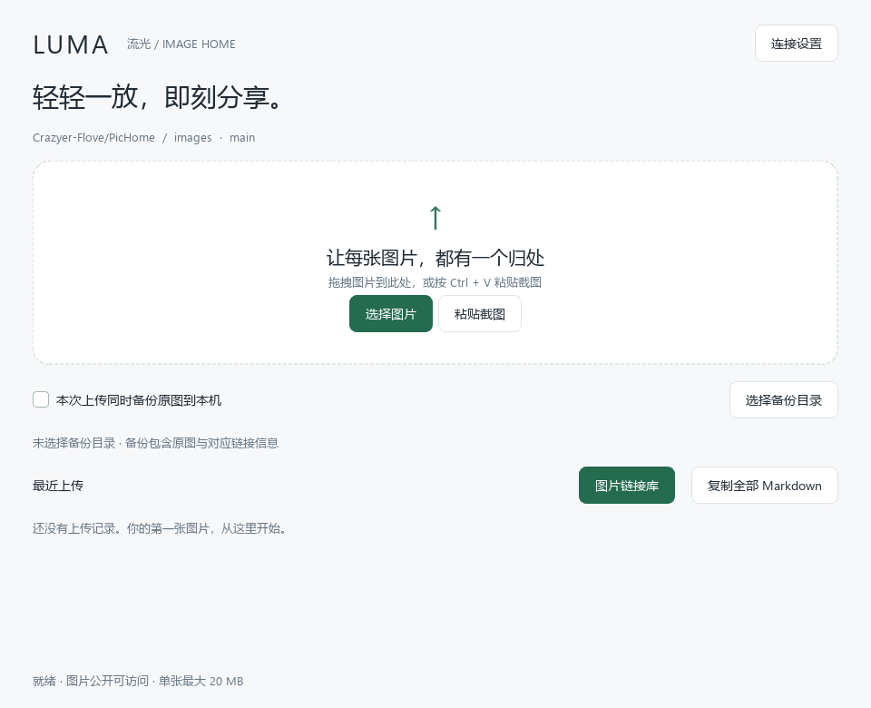
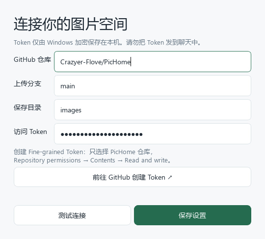
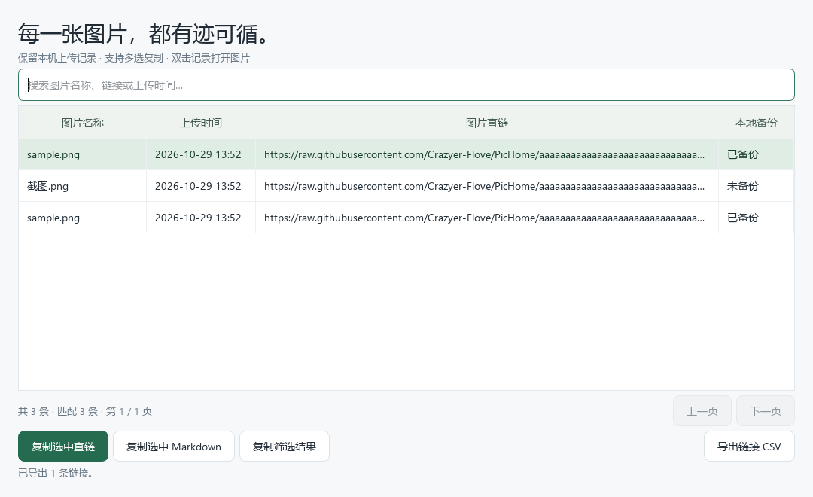

# Luma · 流光

**轻轻一放，即刻分享。**

白色简约的 Windows GitHub 图床客户端，把上传、图片链接管理和可选本地备份放在同一个窗口。

Windows 10 / 11 x64 · 三种上传方式 · 图片链接库 · 原图备份 · CSV 导出



## 功能概览

当前版本 **1.3**：白色卡片、浅灰背景、深绿色按钮和细边框，主窗口、设置窗口和列表窗口保持统一风格。

| 功能 | 说明 |
| --- | --- |
| 拖拽上传 | 拖入本地图片，支持多张文件 |
| 文件选择 | 点击「选择图片」，支持多选 |
| 截图粘贴 | 主窗口按 Ctrl+V 或点击「粘贴截图」 |
| 链接分享 | 复制图片直链或 Markdown，浏览器打开图片 |
| 图片链接库 | 弹出历史列表，搜索、分页浏览、多选复制 |
| 本地原图备份 | 上传前勾选，保存原始图片和对应链接说明 |
| 链接导出 | 将筛选结果导出 CSV，方便保存和查阅 |
| 凭据保护 | Token 通过 Windows DPAPI 加密保存在本机 |

## 快速开始

1. 打开 `Luma-1.3.exe`；自行构建时默认产物名称为 `Luma.exe`。使用 exe 无需安装 Python。
2. 点击右上角「连接设置」，填入 GitHub Token，点击「测试连接」并「保存设置」。
3. 拖拽图片、选择文件，或在主窗口粘贴截图。
4. 上传成功后复制直链或 Markdown；以后可通过「图片链接库」重新查看和复制。

默认配置如下，可在软件中修改为自己拥有写入权限的其他公开仓库。仓库及分支需已存在。

| 设置 | 默认值 |
| --- | --- |
| GitHub 仓库 | `Crazyer-Flove/PicHome` |
| 分支 | `main` |
| 保存目录 | `images` |
| 远程文件路径 | `images/YYYY/MM/随机文件名.扩展名` |

## 申请与配置 GitHub Token



Token 是授权软件写入 GitHub 仓库的凭据。请自行创建后填入软件，不要公开分享或提交到仓库。

1. 登录自己的 GitHub 账号，打开 [Fine-grained Token 创建页](https://github.com/settings/personal-access-tokens/new)，或点击软件内的「前往 GitHub 创建 Token」。
2. **Token name**：填写 `Luma 图床` 等便于识别的名称。
3. **Resource owner**：选择自己的账号，例如 `Crazyer-Flove`。
4. **Expiration**：选择有效期，例如 90 天。到期后重新生成并在软件中更新。
5. **Repository access**：选择 **Only select repositories**，仅勾选 `PicHome`。
6. **Permissions**：添加或找到 **Contents**，选择 **Read and write**。自动附带的 Metadata 读取权限保持默认，其他权限无需添加。
7. 点击 **Generate token**，复制完整 Token，粘贴到软件的「访问 Token」。
8. 核对仓库为 `Crazyer-Flove/PicHome`、分支为 `main`、目录为 `images`，点击「测试连接」，然后「保存设置」。

测试连接检查公开仓库和分支是否可访问；首次实际上传会验证写入权限。Token 到期仅影响后续授权操作，不会使已上传的公开图片链接自动过期。

## 上传与复制链接

### 三种上传入口

- **拖拽**：将一个或多个本地图片文件拖到上传区域。
- **选择**：点击「选择图片」，在文件窗口中多选文件。
- **粘贴**：截图复制到剪贴板后，在主窗口按 `Ctrl + V` 或点击「粘贴截图」。剪贴板中的本地图片文件也可上传。

多张图片按队列串行上传；上传期间可以继续加入图片。请等待队列结束后关闭窗口。失败时会显示原因，修正问题后重新选择或粘贴即可。

### 支持格式

PNG、JPEG、GIF、WebP、BMP、TIFF、AVIF；单张上限为本软件设定的 **20 MiB**。本地文件按原始字节上传，不主动压缩或转换；剪贴板截图保存为 PNG。浏览器对格式的支持不同，TIFF 等文件可能下载而非直接预览。

### 链接形式

```text
https://raw.githubusercontent.com/Crazyer-Flove/PicHome/<commit-sha>/images/2026/10/<id>.png
```

上述地址仅演示结构。直链固定到上传时的提交，不含 Token，不使用临时下载地址。Markdown 格式如下：

```markdown

```

最近上传卡片提供「复制直链」「复制 Markdown」「打开图片」。主界面「复制全部 Markdown」会复制本机保存的全部历史记录。

## 图片链接库



截图记录由界面测试生成，仅用于展示布局，示例链接不代表真实可访问的图片。

点击主界面「最近上传」右侧的 **图片链接库** 按钮，弹出历史列表：

| 操作 | 使用方式 |
| --- | --- |
| 搜索 | 输入图片名称、链接片段或上传时间，实时筛选 |
| 查看图片 | 双击记录，在浏览器打开图片 |
| 多选 | 按住 Ctrl 或 Shift 选择多条 |
| 复制选中直链 | 将选中记录的直链按行复制 |
| 复制选中 Markdown | 将选中记录的 Markdown 按行复制 |
| 复制筛选结果 | 复制全部匹配直链，包含其他页 |
| 导出链接 CSV | 导出全部筛选结果，含名称、时间、直链、Markdown、备份路径 |
| 翻页 | 每页 100 条，点击上一页或下一页 |

主界面展示最近 20 条；链接库保存本机已有的全部历史，没有原先的 500 条限制。列表显示图片名称和链接，图片内容通过双击在浏览器查看。

历史是**本机上传记录**，不会自动扫描 GitHub 仓库。换电脑、清除本地数据、在其他工具上传的图片不会自动出现在列表；旧版已删除或未保存的记录无法恢复。

## 可选本地图片备份

上传前勾选「本次上传同时备份原图到本机」，再「选择备份目录」。成功上传后按年月存放：

```text
你选择的备份目录/
└── 2026-10/
    ├── 随机文件名.png
    └── 随机文件名.png.json
```

- 原图保留上传时的字节，截图备份为 PNG；随机命名避免覆盖同名文件。
- 同名 JSON 包含图片名称、上传时间、直链、Markdown 等，不包含 Token。
- 软件记住备份目录，但每次启动默认不勾选备份。
- 每张图片加入队列时固定当时的备份选项，之后切换不会影响已排队图片。
- 旧图片不会自动补做原图备份。只想备份链接，可在链接库导出 CSV。
- 目录不可写或磁盘空间不足时会提示备份失败，已上传的链接仍会保留。

## 本地数据与版本升级

| 位置 | 内容 |
| --- | --- |
| `%LOCALAPPDATA%\Luma\settings.json` | 仓库设置与加密 Token |
| `%LOCALAPPDATA%\Luma\history.json` | 上传历史与链接 |
| `%LOCALAPPDATA%\Luma\preferences.json` | 上次选择的备份目录 |
| 自选备份目录 | 原图及链接 JSON |

升级时先关闭旧版，再打开新版 exe，即可沿用同一 Windows 用户下保存的设置与记录。DPAPI 绑定当前 Windows 用户，换电脑或换用户后需重新填写 Token。建议定期导出 CSV 并保留重要原图。

## 链接可用性

图片上传到公开仓库，任何拿到链接的人都能访问。链接可长期使用，但不承诺绝对永久：GitHub 服务变化、仓库删除或变为私有、对应提交不再保留等情况可能导致失效。固定提交链接能减少后续移动分支文件对旧链接的影响。

本工具适合个人、小规模图片分享，不是无限容量存储或商业 CDN。部分网络访问 GitHub 可能较慢，重要图片请保留备份。

## 常见问题

| 现象 | 处理方法 |
| --- | --- |
| Token 无效或已过期 | 重新生成 Token，完整粘贴并保存 |
| 上传权限不足 | 确认选中正确仓库，Contents 为 Read and write |
| 仓库或分支不存在 | 检查用户名/仓库名、分支和 Token 的授权仓库 |
| 连接超时、连接被拒绝 | 检查网络与 Windows 系统代理服务是否正常运行 |
| HTTPS 证书验证失败 | 检查系统时间、系统证书与代理证书配置 |
| HTTPS 组件文件缺失 | 使用 1.1 或更高版本，源码构建时使用本仓库脚本 |
| 历史列表缺少旧图片 | 列表只读取本机历史，不自动同步整个远程仓库 |
| 原图备份失败 | 检查备份目录权限和磁盘空间；链接仍可在列表复制 |

## 从源码构建

需要 Windows x64 和 Python 3.10 或更高版本；当前验证环境为 Python 3.12。依赖版本在 `requirements.txt` 中固定。

在项目目录执行：

```powershell
powershell -ExecutionPolicy Bypass -File build.ps1
```

脚本创建 `.venv`、安装依赖、运行核心测试、生成图标并用 PyInstaller 打包。产物为 `dist/Luma.exe`。单文件启动时会解压依赖，首次启动可能需要数秒。

构建脚本隔离 PATH，避免收集其他软件的同名 DLL；如果 Python 运行时依赖额外证书数据，也会一并打包。HTTPS 证书验证保持开启。

### 验证

```powershell
.\.venv\Scripts\python.exe -m unittest -v test_core
.\.venv\Scripts\python.exe smoke_ui.py
.\dist\Luma.exe --network-test
```

核心测试覆盖上传负载、固定提交链接、凭据加密、图片限制、原图及链接备份、备份失败和网络错误处理。界面测试通过模拟 GitHub 响应验证三种上传入口、队列、搜索分页、复制与 CSV 导出，并生成截图。

`--network-test` 不读取 Token，仅检查公开 GitHub API 和图片域名，结果写入当前工作目录 `network-check.json`。真实授权上传仍需配置个人 Token。

### 项目结构

```text
app.py                  界面、队列、链接库与备份选项
core.py                 GitHub API、图片识别、凭据加密与备份
diagnose_network.py     不含凭据的公开网络诊断
test_core.py            核心功能测试
smoke_ui.py             界面集成测试与截图生成
build.ps1               Windows 构建脚本
requirements.txt        依赖版本
docs/screenshots/       README 实机界面截图
```

## 版本记录

- **1.3**：白色简约主题、统一图标、含实机截图的详细文档。
- **1.2**：本地原图备份、图片链接库、搜索分页、多选复制和 CSV 导出。
- **1.1**：修复独立 exe 的 HTTPS 证书数据缺失，完善错误提示。
- **1.0**：三种上传入口、GitHub 存储、直链和 Markdown、本机加密凭据。

## 参考资料

- [GitHub Token 官方说明](https://docs.github.com/en/authentication/keeping-your-account-and-data-secure/managing-your-personal-access-tokens)
- [GitHub Contents API](https://docs.github.com/en/rest/repos/contents#create-or-update-file-contents)
- [GitHub 文件与仓库限制](https://docs.github.com/en/repositories/working-with-files/managing-large-files/about-large-files-on-github)
